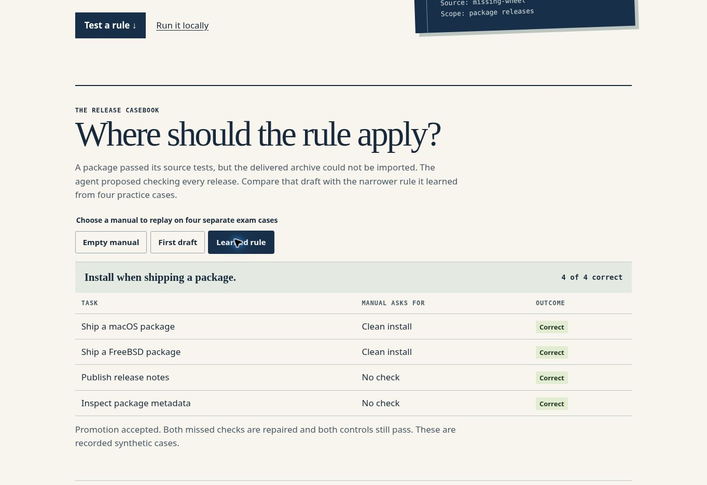

# Verification record for 0.1.1

Run the following at the root of a clean source checkout. The main suite and both demonstrations require Python's standard library only. Network access and Git are required for the separate upstream integration check.

```sh
python3 -m unittest discover -s tests -v
python3 opsbook.py demo
python3 examples/package_trial.py
python3 pstack.py fetch
python3 tests/check_upstream.py
```

The local suite exercises inference, exam isolation during fitting, unsafe generalisation, controls, stale proposals, concurrent promotion, atomic import, instruction installation, rollback, command failures and a real broken archive. CI also verifies the upstream tree and every named workflow entry point. [GitHub Actions runs](https://github.com/Albertito-AI/atlas-opsbook/actions).

Current source also checks that each manual transaction closes its SQLite
connection after success, validation failure and database failure. Successful
case imports persist and failed imports leave the prior state intact. This
avoids retaining database handles until garbage collection during repeated
in-process use. These checks describe the current source, not a replacement
of the previously published 0.1.1 archive.

| Rule in synthetic release exercise | Correct on four exam contexts | New error | Decision |
| --- | ---: | --- | --- |
| Empty manual | 2 | Baseline | Active at start |
| Require installation for every release | 3 | Applies a package check to release notes | Refused |
| Require installation when shipping a package | 4 | None on these cases | Accepted |

The learner received four labelled practice cases. Four further public synthetic examples were used for replay. These eight examples are visible in the distribution and deliberately small. The table is a deterministic routing result. Inspect every case in the [replay output](../examples/replay.json).

The [archive trial](../examples/package-trial-result.json) runs actual Python processes. Before learning, the empty manual selected zero commands. After promotion, the clean-import check exited 1 on a deliberately broken ZIP and exited 0 on the repaired one. The invocation uses isolated Python, a temporary archive and no external service.

Live Cursor and Claude sessions, model judgement across unseen repositories, operator time, model cost and comparative productivity remain open for independent measurement. The [evaluation design](WHITEPAPER.md#how-to-test-a-larger-claim) describes an appropriate next experiment.

The 0.1.1 packer reconstructs the two original Git trees from the combined ZIP and checks their hashes. A regression fixture tests both an executable and a symlink. See the [release incident](../examples/launch-lesson/README.md).

## Current-source maintenance exercise, 14 November 2026

The current-source suite passes 137 tests, including 33 independent execution-ticket tests. The new tests exercise three eight-process claim races, an actual process exit during an uncommitted transaction, bounded retries, clock recovery and uncertain external effects. Review found and corrected a stale-reconciliation race: recovery evidence must identify the exact current attempt's fence. Both stale `applied` and stale `not_applied` decisions are rejected by the regression tests.

The separate `python3 examples/execution_queue_trial.py --contenders 50` exercise started fifty synthetic local processes sharing one SQLite database. Six received distinct claims, forty-four received none and no external action occurred. The recovery fixture blocked an automatic retry after effect-start, accepted explicit synthetic reconciliation and rejected the obsolete worker's completion. The default twelve-process exercise also passed.

These observations concern the [local component](EXECUTION_QUEUE.md) and synthetic fixtures. They do not demonstrate a deployed agent fleet, remote exactly-once effects, production throughput or a completed coordinator adapter. CI repeats the full suite and the default contention exercise. This entry describes current source, not a replacement of the previously published 0.1.1 archive.

## Published download check

On 6 November 2026 the publishing agent downloaded the ZIP and checksum from the public v0.1.1 release page. The ZIP matched SHA-256 `c17c3b4d43074c362a3728c85fe6c4ab42012f22f0ed70dea9dc07ae4397a5bf`. Reconstructing the pstack tree from the downloaded bytes returned `4719e1c4b4c43bac85d4206a8b41dd2899769c1c`. The Claude adapter returned `a38155ce0250f234b4099fbb2dee456741ea5fb1`. All 17 tests passed in the extracted distribution, and the extracted pull-request watcher had its executable bit.



